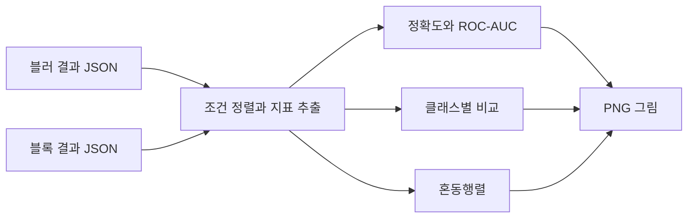

<div align="center">

# 📊 블러·블록 변환과 분류 성능 시각화

### 실험 JSON · 정확도 · ROC-AUC · 혼동행렬

블러 강도와 블록 크기에 따른 분류 결과를 그래프로 비교합니다.<br>
기존 실험 JSON을 읽어 지표·클래스별 분포·종합 대시보드를 생성하는 분석 노트북입니다.


[빠른 시작](#quick-start) · [저장소 구성](#repository-structure) · [입력 데이터](#data-settings)

</div>

---

<a name="introduction"></a>

## ✨ 프로젝트 소개

Gaussian Blur와 블록 변환 실험에서 저장한 결과를 읽어 그림으로 정리합니다. 공개된 핵심 노트북은 결과 시각화를 담당하며, 모델을 처음부터 학습하는 전체 파이프라인을 포함하지 않습니다.

| 기능 | 구현 내용 |
| :--- | :--- |
| 블러 조건 비교 | sigma별 정확도와 ROC-AUC 추세 |
| 클래스별 비교 | 양성·악성·정상의 정확도 그래프와 히트맵 |
| 혼동행렬 | 최소·최대 sigma 조건 비교 |
| 종합 그림 | 여러 지표를 한 화면에 배치한 대시보드 |
| 블록 조건 비교 | 블록 크기별 정확도 막대그래프 |
| 한글 출력 | 나눔고딕 후보 경로 확인과 폰트 설정 |



<a name="repository-structure"></a>

## 📁 저장소 구성

```text
.
├── own-research/
│   └── 그림/
│       └── Blur_Block_1차_그래프_white.ipynb
├── docs/
│   ├── VERSIONS.md
│   └── SANITIZATION.md
└── CHANGELOG.md
```

- [분석 노트북](own-research/그림/Blur_Block_1차_그래프_white.ipynb): 블러·블록 그래프 생성.
- [버전 기록](docs/VERSIONS.md): 공개 파일의 구성.

<a name="implementation"></a>

## 🧩 주요 기술

NumPy로 수치 배열을 구성하고 Matplotlib의 비대화형 `Agg` 백엔드로 PNG를 저장합니다. 블러 sigma는 오름차순, 블록 크기는 내림차순으로 정렬합니다. 그래프 축과 색상은 코드에 정의된 표현 규칙이며 별도의 성능 인증 기준이 아닙니다.

<a name="quick-start"></a>

## 🚀 빠른 시작

```powershell
python -m pip install jupyterlab numpy matplotlib
python -m jupyter lab "own-research/그림/Blur_Block_1차_그래프_white.ipynb"
```

실행하기 전에 다음 환경변수를 자신의 파일 위치로 설정합니다.

| 환경변수 | 용도 |
| :--- | :--- |
| `EXPERIMENT_JSON_PATH_1` | 블러 조건별 결과 JSON |
| `EXPERIMENT_JSON_PATH_2` | 블록 크기별 결과 JSON |
| `EXPERIMENT_OUTPUT_DIR` | 출력 그림을 저장할 폴더 |

노트북의 각 그림 묶음을 확인하며 실행하세요. 두 결과 묶음에는 같은 이름의 출력 파일이 있으므로 결과를 함께 보관하려면 실행 구간별 출력 폴더를 분리해야 합니다. 원본 실험 JSON은 별도로 준비해야 합니다.

<a name="data-settings"></a>

## 📊 데이터 구성과 실험 설정

JSON의 바깥 키는 정수로 변환 가능한 실험 조건입니다. 블러 묶음은 다음 필드를 읽습니다.

| 필드 | 의미 |
| :--- | :--- |
| `acc` | 0~1 범위의 전체 정확도 |
| `roc_auc` | ROC-AUC 값 |
| `per_class_acc` | 클래스별 정확도 사전 |
| `cm` | 혼동행렬 |

`per_class_acc`의 키는 코드와 동일한 `Bengin cases`, `Malignant cases`, `Normal cases`를 사용합니다. 첫 키의 철자를 임의로 바로잡으면 현재 코드의 조회와 달라집니다. 블록 묶음의 막대그래프는 각 조건의 `acc`를 사용합니다.

그림의 80% 선이나 색 구간은 시각화 설정입니다. 블러 강도를 사용한 가로축을 암호학적 안전성이나 개인정보 보호 수준의 검증값으로 해석하지 않습니다. 실제 성능 수치는 자신이 입력한 실험 JSON에 따라 달라집니다.

블록 그래프는 입력 중 가장 큰 블록 값을 `원본`으로 표시하므로 그 항목이 실제 무변환 기준인지 입력 파일에서 확인해야 합니다. 블러의 여섯 번째 그래프 제목에는 `log scale`이 들어 있지만 구현은 문자열 범주축을 사용합니다. 트레이드오프 그림의 가로값도 `log2(max(sigma, 0.5)) × 5`로 계산한 표시용 강도입니다.

<a name="troubleshooting"></a>

## 🛠️ 문제 해결

| 증상 | 확인할 내용 |
| :--- | :--- |
| 환경변수 `KeyError` | 세 입력·출력 환경변수의 설정 여부 |
| JSON 필드 `KeyError` | `acc`, `roc_auc`, `per_class_acc`, `cm`와 클래스 키 철자 |
| 그래프 파일이 바뀜 | 두 묶음이 같은 출력 폴더와 파일명을 사용하는지 확인 |
| 한글이 깨짐 | 나눔고딕 설치 경로와 폰트 검색 결과 |
| 수치 정규화 오류 | 빈 데이터·동일 정확도 조건 등 입력 분포 확인 |

## 📄 최종 논문

[최종 논문 전체 PDF](논문/최종_논문.pdf)를 제공합니다. 제공된 최종 원고의 전체 3쪽이며, 같은 논문의 중간본이나 합본 논문집은 함께 포함하지 않습니다. 원고에 보고된 결과와 이번 저장소 정리 과정의 검증 범위는 구분합니다.

---

<div align="center">

**실험 결과를 같은 축 위에서 비교합니다.**

</div>
